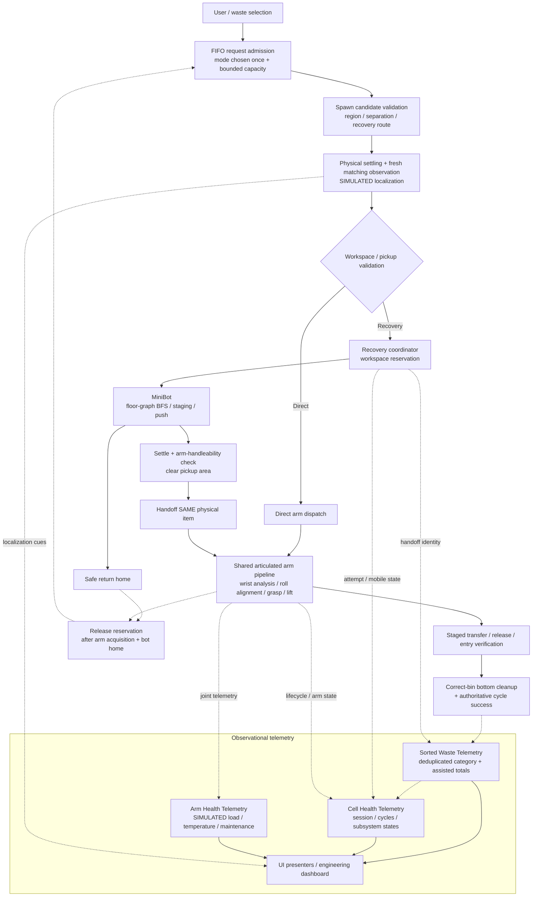

# Technical Architecture

The Smart Recycling Robotic Cell separates admission, perception, planning, control, completion and observational telemetry. Direct and Recovery requests share one arm sorting pipeline. The MiniBot is a separate autonomous subsystem coordinated through recovery reservation and handoff.

## Workflow and data flow

Solid arrows describe work progression. Dotted arrows describe observations or lifecycle feedback.

The branch validates the requested mode and current object geometry; it does not reroll a queued request. Recovery route serviceability is checked before instantiation. Both dispatch paths wait for settling and a fresh observation of the intended item.

## Responsibility boundaries

| Layer | Responsibility |
| --- | --- |
| Admission | Store accepted requests in order, enforce floor/pending limits and reserve a clear recovery workspace. |
| Perception | Produce simulated robot-relative localization, projected bounds and grasp/orientation cues from scene metadata and geometry. |
| Planning | Validate reach and endpoint clearance, construct pickup poses, select roll equivalences and plan MiniBot graph/staging routes. |
| Arm control | Execute joint-target ramps, effort-based grasping, lift, staged transfer and physical release. |
| Recovery control | Navigate, push the assigned dynamic item, verify arm suitability, clear the pickup area and return home. |
| Completion | Verify the configured destination, allow the physical fall to the bin bottom and remove the sorted item. |
| Telemetry / UI | Observe existing outcomes and states, deduplicate counts and format dashboard/camera cues. |

## Shared pipeline and failure lifecycle

Direct dispatch requests the shared sorting workflow. Recovery hands the same physical item directly to that workflow after reach verification and safe retreat; it does not spawn a replacement or duplicate the arm pipeline.

On a non-cancelled pre-handoff recovery failure, the coordinator re-evaluates the same item. An arm-handleable item can use the existing retreat/handoff/return sequence. Otherwise, safe retreat and return occur without another push; terminal unrecoverable cleanup follows confirmed home arrival and reservation release. That cleanup is not recorded as a successful sort.

Sorted telemetry joins correct-bin bottom-cleanup evidence with sorter success. Cell health reuses successful totals and observes terminal lifecycle outcomes. Arm health reads joint telemetry into a simple informational model; it never changes actuation.

## Platform boundary

Editor/macOS and WebGL share the core workflow. Web presentation reduces rendering cost. WebGL also uses an assigned-target, overlap-confirmed pusher-contact compatibility layer; native recovery uses PhysX alone. Neither platform is a real robot controller.

The architecture has no implemented external cloud, ROS, trained vision or hardware connection. Azure and digital-twin connectivity remain future work.

[Return to project showcase](../README.md)
