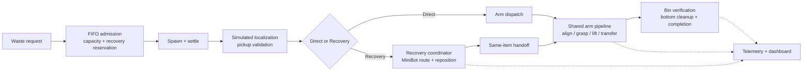
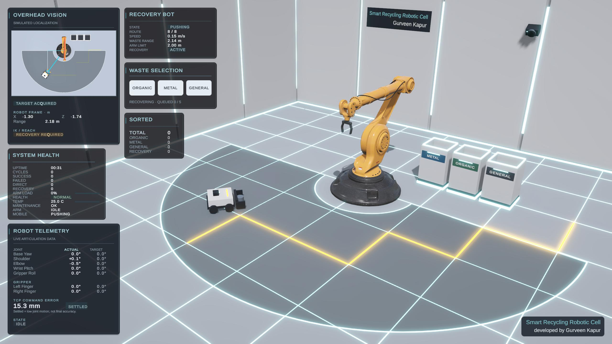
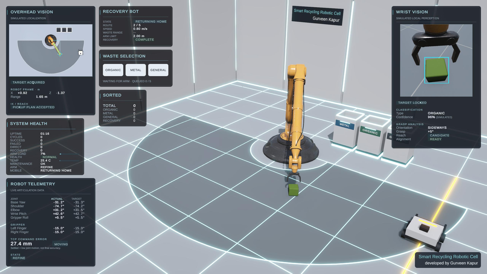
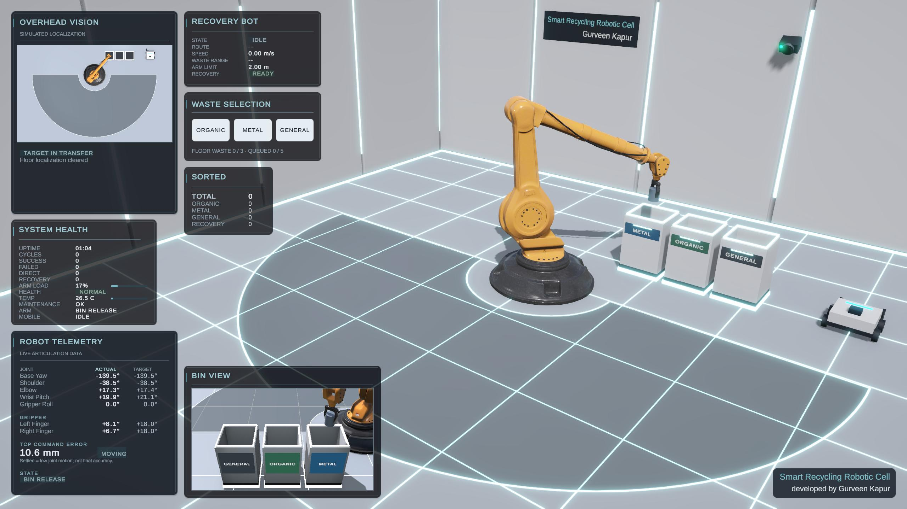

# Smart Recycling Robotic Cell

**Autonomous manipulation · Simulated perception · Mobile recovery**

A Unity robotics simulation by **Gurveen Kapur**

[**Launch Interactive WebGL Demo**](https://gurveenkapur.dev/projects/smart-recycling-robotic-cell/) · [**Watch Full Sorting Video**](https://gurveenkapur.dev/projects/videos/robotic-cell-full-sorting.mp4) · [**Explore Architecture**](Docs/architecture.md)

**Unity 6.3 LTS · C# · PhysX / ArticulationBody · URP · WebGL**

## Overview

What happens when waste lands beyond a robot arm's reach?

This simulated recycling cell coordinates an articulated arm and a separate Recovery MiniBot to handle both reachable and out-of-reach objects. The arm localizes, aligns, grasps and sorts waste. The MiniBot repositions out-of-reach waste and hands the **same physical item** to the arm's existing pickup pipeline.

The project brings together robotics control, physical interaction, multi-robot coordination and an industrial engineering dashboard. This public repository is a **portfolio showcase containing documentation and captured screenshots**. The production Unity source code and project assets remain private. Unity source, project assets and build files are not distributed here.

> **Simulation scope:** perception uses Unity scene metadata, geometry and camera projection. Arm load, temperature and maintenance recommendations use simple simulated models. These are not real sensor measurements, trained computer vision, or predictive maintenance.

## Implemented capabilities

| Area | Demonstrated engineering |
| --- | --- |
| Articulated manipulation | Joint-limited, drive-controlled arm motion; position IK; staged approach/transfer; endpoint floor and pedestal clearance checks. |
| Physical grasping | Two-finger effort-based clamping, bilateral contact confirmation and orientation-aware gripper roll. Waste stays dynamic through pickup and release. |
| Simulated perception | Overhead robot-relative localization and workspace evaluation; Wrist Vision bounds, orientation and grasp-alignment cues. |
| Mobile recovery | Floor-graph BFS routing, staging, inward pushing, reach verification, safe handoff and return home. |
| Request orchestration | Bounded FIFO admission, floor-capacity checks, spawn separation and exclusive recovery-workspace reservation. |
| Completion verification | Correct/wrong-bin entry feedback, physical bottom cleanup and deduplicated successful-sort counts. |
| Engineering telemetry | Session/cycle totals, recovery-assisted counts, actual/target joint values and informational simulated health indicators. |
| Presentation | Overhead, Wrist and Bin camera feeds, destination-rim guidance, industrial dashboard and browser introduction. |

### Three supported waste streams

| Waste | Destination |
| --- | --- |
| Organic | Green bin |
| Metal | Blue bin |
| General | Grey bin |

Destination references define the routing; color provides visual identification.

## Try the simulation

1. Open the [WebGL demo](https://gurveenkapur.dev/projects/smart-recycling-robotic-cell/) in a modern desktop browser and select **START SIMULATION**.
2. Use **ORGANIC**, **METAL** or **GENERAL** in Waste Selection. Requests automatically enter the existing admission workflow.
3. Watch either direct arm pickup or MiniBot recovery followed by arm handoff. Additional accepted requests wait in FIFO order.
4. Follow localization in Overhead Vision, grasp analysis in Wrist Vision and release in Bin View. The dashboard records verified completion.

Keyboard `1` / `2` / `3` request Organic / Metal / General. **INFO** reopens the instructions; its **CONTINUE SIMULATION** button returns to the running cell.

The browser version uses reduced visual fidelity for performance. The screenshots below are captured project views; appearance can differ from the WebGL presentation. The [sorting video](https://gurveenkapur.dev/projects/videos/robotic-cell-full-sorting.mp4) provides a non-interactive walkthrough.

## Architecture

Request mode is selected once at acceptance. The diagram's branch represents validation and dispatch of that selected workflow, not a second random selection. Recovery reserves the workspace and returns the same item to the shared arm pipeline. Telemetry observes state and completion; it does not command motion.

[Detailed architecture and subsystem boundaries →](Docs/architecture.md)

## Technical challenges and design decisions

### Stable physical manipulation

A grasp must survive lift and loaded yaw without relying on parenting or fixed-joint attachment. The cell combines bilateral contact checks, bounded effort-based clamping and controlled arm target ramps. Orientation equivalence avoids unnecessary wrist rotation while aligning the jaws with the selected grasp axis.

### Coordinating two autonomous subsystems

The mobile robot extends the useful workspace without extending the arm's limits. FIFO admission and a recovery reservation clear conflicting floor work before pushing. Handoff requires a settled, arm-handleable target; admission resumes after arm acquisition and MiniBot home arrival.

### Keeping preview, execution and presentation consistent

Read-only pickup previews use the working planner's geometry assumptions. An accepted active plan takes precedence over the preview. Target-specific visual cues follow the target lifecycle so stale localization does not flash between items.

### Recording outcomes rather than activity

Successful sorted counts require correct-bin bottom cleanup and authoritative sorter success, with duplicate receipts ignored. Session health observes terminal outcomes; transient states are not independent failed cycles. Simulated health indicators remain separate from robot control.

### Preserving the browser workflow

Web presentation uses a centralized quality profile. A narrowly scoped WebGL contact-compatibility layer supports assigned-target MiniBot pushing when contact overlap is confirmed; native recovery uses PhysX contact alone. This is a simulation compatibility mechanism, not a claim of identical physics across platforms.

## Project Gallery

### Recovery process

The separate MiniBot repositions waste outside the arm's normal reach and coordinates handoff.

### Grasping process

Wrist Vision presents simulated local geometry and alignment information alongside the physical arm and gripper.

### Sorting process

The arm transfers waste to its destination bin; Bin View shows release and telemetry records verified completion.

## Validation approach

The private Unity project contains Unity Test Framework / NUnit tests covering geometry, IK and motion schedules, orientation alignment, recovery routing/lifecycle, FIFO admission, bin completion and telemetry/health rules. Targeted Editor Play Mode and WebGL checks complement those tests for physical interaction and full-cycle behavior.

No current passing-test total or universal grasp-reliability claim is made here. This showcase does not include source or an executable test suite.

## Boundaries and future work

**Implemented:** a configured local simulation with Organic, Metal and General sorting, coordinated mobile recovery, simulated perception and session telemetry.

**Not implemented:** real image-based CV/AI inference, physical robot control, ROS integration, Azure IoT Hub, Azure Digital Twins, cloud telemetry or predictive maintenance. Glass remains incomplete development scaffolding and is not a supported demo stream.

Possible future work includes image-based perception, richer fault models, more complete collision-aware planning and cloud/digital-twin integration. These are future directions, not current capabilities. The current motion workflow uses staged poses and clearance checks; it is not an industrial safety system or a general-purpose motion planner.

---

**Created by Gurveen Kapur** · [Interactive demo](https://gurveenkapur.dev/projects/smart-recycling-robotic-cell/) · [Sorting video](https://gurveenkapur.dev/projects/videos/robotic-cell-full-sorting.mp4)
